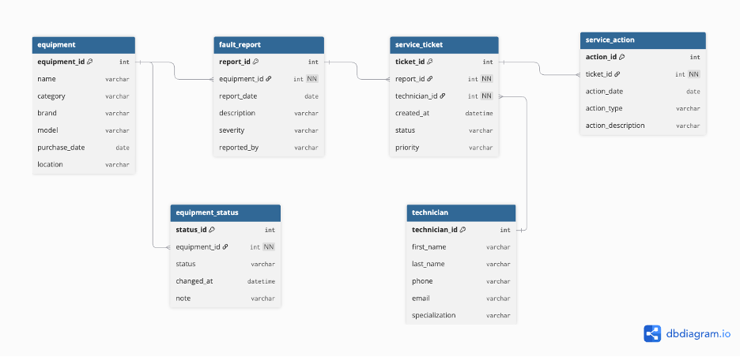

# Gym Equipment Maintenance Database

A MySQL database with a Python command-line app for keeping track of gym
equipment, fault reports and service work.



## Features
- View all equipment and its status history
- View fault reports, service tickets and the actions taken on each ticket
- Create service tickets through a stored procedure
- Close service tickets – a trigger automatically logs the new equipment status
- Statistics on faults per equipment and technician workload

## Tech
Python · MySQL · mysql-connector-python

## Getting started
1. Create the database and sample data:
   ```bash
   mysql -u root -p < database.sql
   ```
2. Install the MySQL connector:
   ```bash
   pip install mysql-connector-python
   ```
3. Set your MySQL password in `create_connection()` in `app.py`, then run:
   ```bash
   python app.py
   ```

The sample data is fictional.
